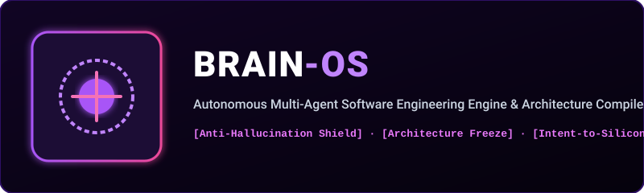

  

  
  
  
  

---

## 🧠 What is BrainOS?

**BrainOS** is an autonomous multi-agent software engineering framework and Intent-to-Code architecture compiler. Unlike generic prompt wrappers that hallucinate syntax and leak credentials, BrainOS provides deterministic guardrails:
1. **Semantic Intent Parser**: Deconstructs natural human intent into strict structural dependency graphs.
2. **Anti-Hallucination Shield**: Intercepts synthetic code and flags alien syntax leaks (def, unction, curly braces).
3. **Architecture Freeze & Guard**: Locks mission-critical foundations (Lexer, Parser, VM) against accidental AI mutations.
4. **Token-Budgeting Context Handoff**: Compresses complex multi-turn developer state into compact handoff vectors (&lt; 50 tokens).

---

## 🏛️ System Architecture

`mermaid
flowchart TD
    subgraph HumanInput["Human / Agent Intent"]
        INT["Natural Language Developer Intent"] --> PARSE["Semantic Intent Parser & Entity Resolver"]
    end

    subgraph BrainEngine["BrainOS Autonomous Core"]
        PARSE --> ARCH["Architecture Generator & Decision Graph"]
        ARCH --> CRITIC["Self-Critic & Tradeoff Evaluation Engine"]
        CRITIC --> SHIELD["Anti-Hallucination & Security Guard"]
    end

    subgraph ProductionOutput["Deterministic Silicon Code"]
        SHIELD --> CODE["Self-Contained Single-File Target Application"]
        SHIELD --> HANDOFF["Token-Budgeted Session Checkpoint (< 50 tokens)"]
    end
`

---

## 🛡️ Production Verification Proof

Run the verification test:
`ash
aayu run examples/test_brain.aayu
`

Output:
`
========================================
     AAYU BRAINOS AI-GUARD SYSTEM       
========================================
[1] Analyzing AI Generated Code for Hallucinations:
    Code under inspection: def calculate_price(x) let total = x * 2 print(total)
    Detected Issues: ["Hallucination: Python 'def' detected. Use 'action <name>'."]
    Suggested Auto-Fixes: ["Replace 'def' with 'action' and add 'end' at block close."]

[2] Testing Token Exhaustion Context Handoff:
    Compact Handoff String (< 50 tokens):
    [AAYU-BRAIN-HANDOFF] Task: MILESTONE_4 | Status: CHECKPOINT_ACTIVE | Rule: Frozen: [Lexer, Parser, VM].

[3] Testing Security Guard on Hardcoded Credentials:
    Code: let api_key = "sk-proj-99881122"
    Security Issues: ["Security Alert: Hardcoded API key detected."]

[4] Architecture Freeze:
    Is 'Lexer' protected against AI refactoring? -> 1 (TRUE)
========================================
   [AAYU BRAINOS VALIDATION SUCCESS]    
========================================
`

---

## 📄 License
MIT License (c) 2026 Ayush Kaushik ([@Ghrit-igl](https://github.com/Ghrit-igl)).